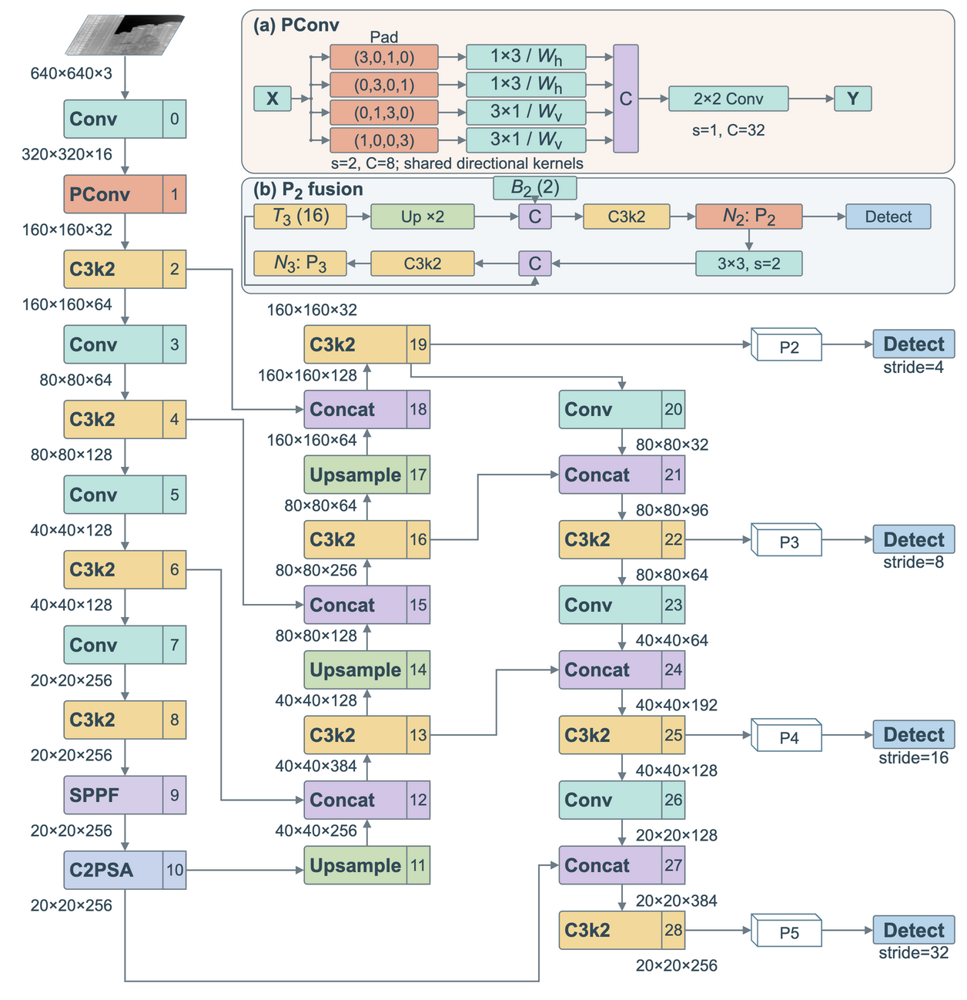
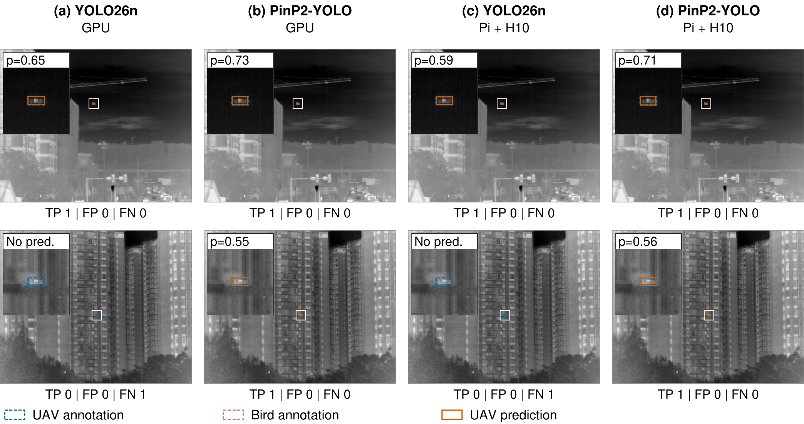

# MPU Big Data Project 2 · 红外无人机检测

本项目研究小型红外无人机的检测与边缘部署。在YOLO26n上加入浅层风车卷积（PConv）和高分辨率P2检测分支，形成 **PinP2-YOLO**，并在树莓派5＋HAILO10H上完成推理测试。

**课程汇报** · [打开 HTML 汇报（含演示视频）](https://yaoronghuang.top/MPU-Big-Data-Project2-UAV-Detection/presentation/)

## GUI demonstration / 操作演示

https://github.com/user-attachments/assets/ad5af9a7-2ece-4dd1-8940-8daeae079ef7

**3分46秒**：树莓派本机H10检测，展示图片检测、时间文字过滤、视频检测及暂停／恢复。
英文讲解、双语字幕、操作放大，无背景音乐。上方为完整720p预览；
[下载1080p原版视频](https://github.com/EmpyreanHYR/MPU-Big-Data-Project2-UAV-Detection/releases/download/gui-h10-v1.0.0/PinP2_H10_GUI_narrated_demo.mp4) ·
[双语字幕](https://github.com/EmpyreanHYR/MPU-Big-Data-Project2-UAV-Detection/releases/download/gui-h10-v1.0.0/PinP2_H10_GUI_bilingual.srt) ·
[模型与视频Release](https://github.com/EmpyreanHYR/MPU-Big-Data-Project2-UAV-Detection/releases/tag/gui-h10-v1.0.0)。
视频素材为30张红外图片的循环播放。该素材在conf≥0.25、IoU≥0.5下检出0个目标、漏检30个，时间文字过滤使误报18→8；[同图诊断](docs/results/LOCALIZATION_DIAGNOSIS_20261116.md)给出FP32/H10对照与标注尺度分析。因此演示用于展示操作流程，检测精度以[实验结果](docs/results/EXPERIMENT_TABLES_20261105.md)为准。

## Real detection / 实际检测

已公开与本项目真机验收一致的 **HAILO10H HEF模型＋解码元数据**。
在树莓派的完整仓库中执行：

```sh
python3 scripts/download_gui_model.py
python3 scripts/download_gui_model.py --verify-only
```

模型安装到 `models/pinp2_h10/`，下载器自动核对压缩包及每个文件的SHA256。之后按[真机配置与启动步骤](docs/GUI_REPRODUCIBILITY.md#4-prepare-real-h10-detection--准备真机)
指定自己的图片／视频，即可推理。运行环境为树莓派5＋HAILO10H＋HailoRT5.1.1。

## Quick GUI check / 无设备检查界面

完整步骤见[GUI复现指南](docs/GUI_REPRODUCIBILITY.md)。使用Python3.12+，在仓库根目录执行：

```sh
python3 -m venv .venv-gui
.venv-gui/bin/python -m pip install -e '.[gui]' -c constraints/gui-desktop-20261116.txt
.venv-gui/bin/python scripts/prepare_gui_smoke_demo.py
.venv-gui/bin/python scripts/run_gui.py --config outputs/gui_smoke/demo.json
```

这个入口使用标注为合成的样例图片和预测检查界面；真实图片／视频检测使用上方公开的模型包和树莓派5＋HAILO10H，配置模板位于[configs/gui](configs/gui/README.md)。自动检查运行 `python scripts/check_gui.py`。

## 组员从哪里开始

1. 阅读[项目进展与待办](docs/PROJECT_STATUS.md)，了解已完成的工作、结论和剩余事项。
2. 阅读[中文报告](docs/report/report_zh.md)；汇报与提交以[英文报告PDF](docs/report/report.pdf)为准。
3. 做PPT时使用[当前网络图](docs/report/figures/final_pconv_p2.pdf)和[实验结果导航](docs/results/README.md)。
4. 修改代码前查看[环境说明](docs/ENVIRONMENT.md)、[配置导航](configs/README.md)和[部署入口](scripts/deployment/README.md)。
5. 课堂演示使用 [PyQt6 检测工作台](docs/GUI.md)：实验结果回放、H10 实时检测客户端、图片／视频导出和实验结果对比。Mac 可双击 `启动检测演示.command`；真机演示使用 [启动H10实时检测.command](启动H10实时检测.command)（先安装 GUI 依赖并准备本机连接配置）。树莓派显示器演示使用 [启动树莓派本机演示.command](启动树莓派本机演示.command)，素材缓存一次、本机检测；[演示与录制说明](docs/DEMO_REHEARSAL.md)。[3分46秒英文配音演示](docs/results/GUI_NARRATED_20261116.md)含双语字幕、操作放大和时间文字过滤，另有[完整录屏](docs/results/GUI_RECORDING_20261116.md)和[图片与视频H10联调](docs/results/GUI_H10_20261116.md)记录。

## 已完成什么

| 工作 | 结果与入口 |
|---|---|
| 数据整理 | SIRST-UAVB固定1999张训练／500张验证，验证集486个UAV框；[来源与标注](docs/datasets/SOURCES.md) |
| 模型比较与消融 | 主比较11个从零100轮模型，累计19个有效权重；[四类实验表](docs/results/EXPERIMENT_TABLES_20261105.md) |
| 训练比例 | 500／1000／1999张训练图，统一500张验证；[三档实测](docs/results/TRAINING_FRACTIONS_20261107.md) |
| 边缘测试 | GPU19组、Pi CPU17组、H10兼容模型7组；[设备结果](docs/results/EDGE_EXTENSION_20261104.md) |
| 后处理改进 | NMS IoU0.4使H10误报119→62，检出323、漏检163不变；[审计与硬件实测](docs/results/NMS_VLM_AUDIT_20261115.md) |
| 视觉语言复核 | Qwen2.5-VL-3B-Instruct的E0—E4共689条响应；[结果](docs/results/NMS_VLM_AUDIT_20261115.md)未优于相同召回率下的置信度阈值对照 |
| 报告与图表 | [10页IEEE报告、中文稿及可编辑图源](docs/report/README.md) |

当前PinP2/H10默认部署的AP50:95为 **31.740%**（内部验证集），三轮阈值基准为 **22.89±0.01 FPS**；原生训练验证、FP32、无NMS和NMS后的指标分别记录。

本项目与课程主题的联系很具体：去重和冲突标注决定了验证集是否可信，训练量实验覆盖500至1999张，部署侧记录了H10吞吐和峰值内存。视觉语言复核为离线实验，结果支持维持置信度阈值过滤。

四名组员的具体工作、遇到的困难与反思见 [Contribution/](Contribution/)：`01_Yaorong_Huang.md` 至 `04_Zhiwen_Luo.md`；报告附录A.1—A.4为对应的英文版。

## 主要结果 / Results at a glance

> 口径：训练与内部验证只用清理后的SIRST-UAVB（1999张训练／500张验证，验证集486个UAV框）。“原生”指标取最佳AP50:95检查点；部署指标在同一批500张图上按conf≥0.25、IoU≥0.5一对一匹配重算。下表数字均为实测，完整逐项记录见[四类实验表](docs/results/EXPERIMENT_TABLES_20261105.md)。

### 模型结构



在YOLO26n上加入浅层风车卷积（PConv）与stride-4 P2分支后，参数量为2.516 M；保留原有端到端检测头，P2把浅层细节送回高分辨率检测层用于小目标定位。

### 主比较与消融（原生验证，AP单位%）

| 模型 | 参数(M) | P | R | F1 | AP50 | AP50:95 |
|---|---:|---:|---:|---:|---:|---:|
| YOLO26n | 2.504 | 71.32 | 60.39 | 65.40 | 65.76 | 27.95 |
| YOLO11n | 2.590 | 80.26 | 65.23 | 71.97 | 68.14 | 27.04 |
| YOLOv8n | 3.011 | 83.82 | 66.08 | 73.90 | 71.43 | 26.63 |
| PConv + SD (YOLOv8n-P2) | 2.928 | 84.13 | 70.17 | 76.52 | 76.58 | 32.93 |
| PinP2-YOLO | 2.516 | 82.49 | 62.03 | 70.81 | 69.61 | 31.27 |

递增消融说明单独改动会误导：只加PConv使AP50:95下降3.571个百分点，再加P2后回升6.893个百分点，组合相对基线净增3.322个百分点；只加P2也有2.023个百分点增益。所有比较均为从零100轮、单一种子42，消融组物理batch不同，结论限于本验证集。

| 配置 | PConv | P2 | 物理batch | AP50:95(%) | ΔAP(pp) |
|---|---|---|---:|---:|---:|
| B0：YOLO26n | 0 | 0 | 32 | 27.95 | +0.000 |
| B1：仅PConv | 1 | 0 | 32 | 24.38 | −3.571 |
| B2：仅P2 | 0 | 1 | 8 | 29.98 | +2.023 |
| B3：PinP2-YOLO | 1 | 1 | 8 | 31.27 | +3.322 |

### 训练数据量（同一500张验证图）

| 训练比例 | 训练图数 | 原生AP50:95(%) | GPU AP50:95(%) | GPU漏检(%) |
|---|---:|---:|---:|---:|
| 25% | 500 | 16.35 | 7.08 | 57.61 |
| 50% | 1000 | 24.54 | 13.79 | 43.00 |
| 100% | 1999 | 31.27 | 25.19 | 32.51 |

25%与50%各新训100轮，100%复用全量结果；固定轮数下优化步数随数据量变化，见[训练比例实测](docs/results/TRAINING_FRACTIONS_20261107.md)。

### 边缘设备对比

AP与漏检为百分数；**斜杠顺序固定为GPU／Pi CPU／Pi H10**。FPS含前后处理；大小顺序为ONNX／HEF，RSS顺序为Pi CPU／H10（MiB）。

| 模型 | AP50:95 G/P/H | 漏检 G/P/H | FPS G/P/H | 大小 O/H | RSS P/H |
|---|---:|---:|---:|---:|---:|
| YOLO26n | 20.84/20.84/15.20 | 36.21/36.21/35.39 | 47.38/6.51/30.06 | 9.32/4.92 | 165.9/85.3 |
| YOLO11n | 27.37/27.37/26.07 | 32.10/32.10/34.36 | 53.01/5.68/18.54 | 10.09/4.91 | 163.5/84.2 |
| YOLOv8n | 25.63/25.63/24.81 | 30.86/30.86/30.45 | 64.22/5.53/18.85 | 11.69/4.57 | 149.0/85.4 |
| PinP2-YOLO | 25.19/25.19/24.35 | 32.51/32.51/33.54 | 38.59/4.13/22.72 | 9.96/4.02 | 250.4/86.3 |

注意原生与共同FP32部署口径不同，且上表PConv＋SD虽然原生AP最高，其H10 AP只有18.125%、误报331、7.17 FPS；不能只看一列判断模型。未测项（E1/E2）及原因见[完整设备表](docs/results/EXPERIMENT_TABLES_20261105.md)。

### 后处理与外部迁移

原YOLO26端到端分支不做NMS；在H10重放NMS后，保持TP323／FN163不变：

| 部署策略 | H10 AP50:95(%) | H10误报(FP) | 管线FPS |
|---|---:|---:|---:|
| 无NMS | 24.351 | 119 | 22.86±0.02 |
| NMS IoU 0.4（默认） | 31.740 | 62 | 22.89±0.01 |

NMS自身平均26.3±0.1微秒／图，几乎不影响吞吐；阈值在本次验证集上选定。[同图对比](docs/report/figures/nms_same_image.png)展示了原图、无NMS与不同IoU阈值的框。冻结的PinP2权重在AUVD-Seg300外部迁移案例上原生AP50为33.008%、AP50:95为11.494%，不进行外部微调或阈值选择；与内部31.274%的差距反映跨传感器与标注规范的难度，H10与NMS策略的跨界表现尚未评价。



上述结果仍有限制：消融只有一个种子，目标过小时仍会漏检，阈值依赖同一验证集；视觉语言复核未优于置信度过滤。结论与限制以[报告](docs/report/report.pdf)为准。

## 目录怎么用

| 目录 | 内容 |
|---|---|
| `src/uav_detection/` | 模型结构、训练适配、数据处理与 PyQt GUI 代码 |
| `configs/` | 当前模型与部署参数，以及有日期说明的历史实验配置 |
| `scripts/`、`tests/` | 数据准备、训练入口、指标复算、部署、文档构建与检查，以及对应测试 |
| `experiments/` | NMS审计和视觉语言复核的分析代码 |
| `presentation/` | 离线 HTML 汇报、讲稿、问答备份与逐图数据出处 |
| `docs/report/` | 当前报告、图表及复现说明 |
| `docs/results/` | 当前结果入口与有来源的历史对照证据 |
| `docs/proposal/` | 已提交提案 |
| `bibliography/`、`templates/`、`third_party/` | 统一文献、原始模板及第三方来源与许可 |
| `.github/`、`constraints/` | CI 工作流与 GUI 依赖锁定 |
| `data/`、`models/`、`outputs/` | 本地数据、权重及处理证据的导航说明；实际大文件与私有运行记录不随仓库分发 |

## Model weights / 模型权重

最终模型（YOLO26n＋PConv＋P2，从零100轮）的权重、ONNX和H10模型通过GitHub Release提供：

| 内容 | 位置 |
|---|---|
| `best.pt`（最佳AP95第85轮，FP32）、`model.onnx`（opset17）、`model.hef`，以及结构、配置和选型记录 | [pinp2-final-model-v1.1.0](https://github.com/EmpyreanHYR/MPU-Big-Data-Project2-UAV-Detection/releases/download/pinp2-final-model-v1.1.0/pinp2-final-model-v1.1.0.zip)（含`SHA256SUMS`） |
| GUI真机包（HEF＋解码元数据，逐文件SHA256自动核验）与3分46秒演示视频 | [gui-h10-v1.0.0](https://github.com/EmpyreanHYR/MPU-Big-Data-Project2-UAV-Detection/releases/tag/gui-h10-v1.0.0) |

PyTorch检查点使用仓库[模型构建入口](src/uav_detection/architecture.py)按`best.pt`内嵌的YAML元数据重建PConv层后加载。其余18组对照与消融模型的权重、逐图预测和完整设备记录保存在项目私有结果包中，版本与哈希见[复现说明](docs/report/REPRODUCIBILITY_NOTES.md)。

## Data / 数据

原始数据从各数据集的公开发布处获取。训练与内部验证使用SIRST-UAVB；外部迁移评价使用AUVD-Seg300，其冻结权重在外部数据上不微调，也不用于选点或调阈值。数据来源、作者链接与获取方式见[数据来源说明](docs/datasets/SOURCES.md)，处理流程见[数据处理流程](docs/datasets/PREPARATION.md)。

## 本地检查与报告构建

使用Python3.10+，在自己的虚拟环境中执行：

```sh
python -m pip install -e '.[evaluation]'
python scripts/check_project.py
```

检查入口运行仓库检查、引用检查和Git跟踪的全部测试；模型集成测试需要完整的Torch依赖，在普通桌面环境会被跳过。仅改文档时可直接运行 `python scripts/check_repository.py` 和 `python scripts/check_references.py`；归档后的本机环境缺少 NumPy 等依赖，`check_project.py` 可能报缺少模块，不影响前两项检查。

安装pdfLaTeX和BibTeX后，可用 `python scripts/build_report.py` 编译报告；提案构建使用 `python scripts/build_proposal.py`。文献修改以 `bibliography/references.bib` 为准，同步副本后运行检查。

报告与幻灯片截止 **2026年11月29日24:00（北京时间）**，12月3日汇报，10分钟讲述＋5分钟问答。3分46秒演示视频已完成，剩余提交材料按[核查清单](docs/report/REVIEW_CHECKLIST.md)整理；文档与成果的维护约定见[维护说明](docs/REPOSITORY_MAINTENANCE.md)。
