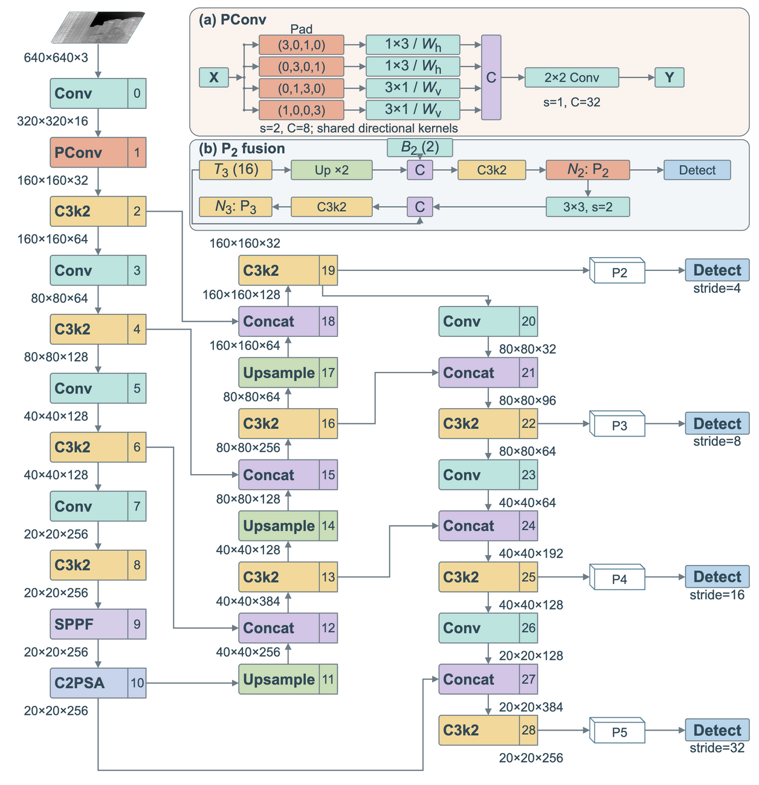
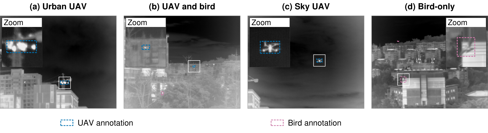
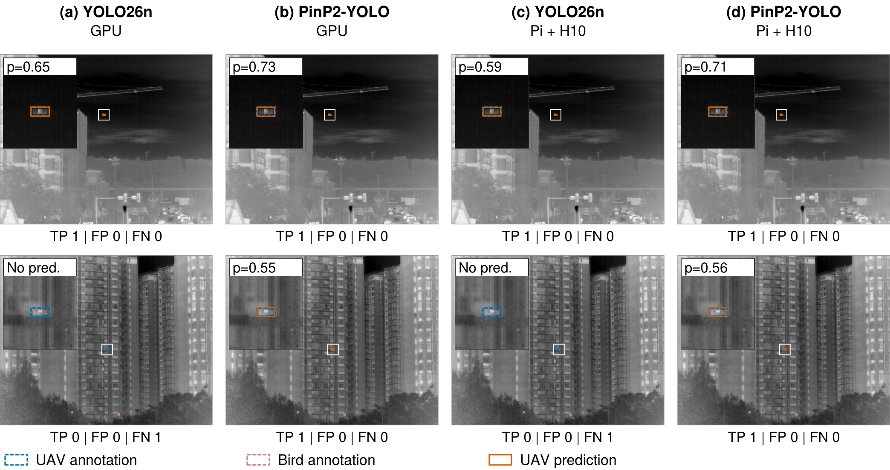
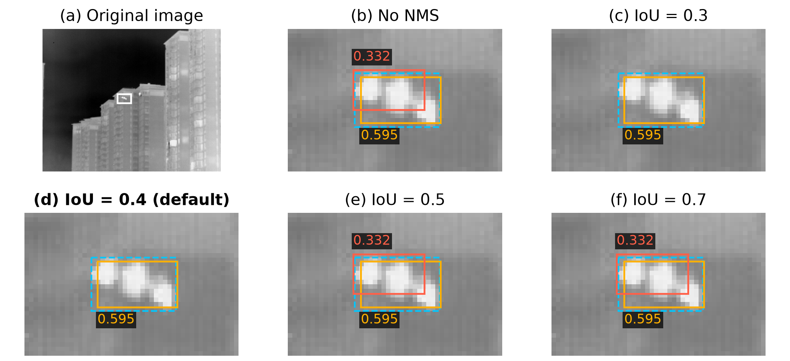

# PinP2-YOLO：面向红外无人机检测的方向特征提取与高分辨率融合

Yaorong Huang、Chunshen Yu、Yifan Zhai、Zhiwen Luo  
澳门理工大学（Macao Polytechnic University）

## 摘要

远距离红外无人机可能仅占几个像素。PinP2-YOLO在YOLO26n中结合浅层风车形卷积（PConv）与步长4的P2融合，以适应红外小目标检测。在清理后的SIRST-UAVB验证集上，相较YOLO26n，单独加入PConv使原生AP50:95下降3.571个百分点，单独加入P2使其提高2.023个百分点，两者组合提高3.322个百分点。使用同一批500张验证图在树莓派5＋Hailo-10H原无NMS管线上实测，相较原YOLO26n，PinP2-YOLO的部署AP50:95从15.204%升至24.351%，漏检率从35.391%降至33.539%，管线吞吐从30.06降至22.72 FPS。最终部署默认采用NMS IoU0.4：AP50:95达到31.740%，固定阈值召回不变，硬件实测为22.89 FPS，NMS自身平均26.3微秒／图。候选VLM复核大幅损失召回，未优于单纯置信度过滤。

**关键词：** 红外无人机检测；PinP2-YOLO；风车形卷积；高分辨率融合；边缘部署。

## 1 引言

远距离红外无人机可能仅占几个像素，微弱纹理容易受到建筑和云层干扰。上下文与形状建模方法旨在保留这类弱信号[[1]](#ref-dai2021acm)、[[2]](#ref-zhang2022isnet)、[[3]](#ref-li2023dnanet)。目标框过小时，轻微坐标偏差也会显著改变交并比（IoU），增加定位难度[[4]](#ref-wang2021nwd)。

YOLO在单次前向流程中预测位置与得分[[5]](#ref-redmon2016yolo)；YOLO26采用不含分布焦点损失（DFL）的端到端检测头[[6]](#ref-jocher2026yolo26)、[[7]](#ref-ultralytics2026docs)。连续下采样可能丢失微小无人机的空间证据。更精细的预测尺度保留更多位置，同时增加特征图访问和边缘内存。本文检验方向性浅层采样与精细尺度融合对YOLO26n的改善，以及这一改善保留至硬件转换之后的程度。

PinP2-YOLO全称为Pinwheel-enhanced P2 Fusion YOLO，将浅层PConv与P2融合用于YOLO26n。PConv提供方向性采样[[8]](#ref-yang2025pconv)，步长4路径连接浅层细节与高层上下文。图1展示实际网络及两种机制。

本文的贡献包括面向红外小目标的YOLO26n结构改进，以及该改进在树莓派5＋Hailo-10H上的实测评价。四组消融分别考察PConv、P2及两者的组合，并在固定验证集上与其他检测器比较AP、漏检率、吞吐和内存。参数量难以单独预测推理开销[[9]](#ref-ma2018shufflenet)。

## 2 相关工作

### 2.1 红外小目标表示

红外目标方法利用周围上下文建模微弱局部信号。ACM通过非对称上下文调制交换高层语义和低层细节[[1]](#ref-dai2021acm)；DNANet使用密集嵌套注意力进行特征交互[[3]](#ref-li2023dnanet)；ISNet建模形状与双方向注意力[[2]](#ref-zhang2022isnet)。这些方法表明，浅层空间表示对红外小目标检测具有研究价值。

PConv原工作结合方向卷积与基于尺度的动态损失[[8]](#ref-yang2025pconv)。本文在YOLO26n的浅层引入PConv算子，并以PConv＋SD／YOLOv8n-P2作为另一组对照模型。NWD针对微小框的定位敏感性[[4]](#ref-wang2021nwd)，本文的误差分析借鉴其思路，训练与评价仍采用IoU。

### 2.2 检测与多尺度融合

YOLO建立了从图像直接预测目标框的框架[[5]](#ref-redmon2016yolo)。当前实现包括轻量YOLOv8n、YOLO11n和YOLO26[[10]](#ref-ultralyticscode)、[[6]](#ref-jocher2026yolo26)。RT-DETR结合查询选择与混合编码器，实现实时Transformer检测[[11]](#ref-zhao2024rtdetr)。PF-RPN研究图像感知和自提示区域提议[[12]](#ref-tang2026pfrpn)、[[13]](#ref-pfrpncode)；本文SIA适配对YOLO颈部特征施加图像条件稀疏注意力；SIA＋CSP再加入级联自提示更新。

FPN利用自顶向下层级及横向连接传播语义[[14]](#ref-lin2017fpn)；PANet加强定位信息的反向流动[[15]](#ref-liu2018panet)；EfficientDet研究加权双向特征融合与联合模型缩放[[16]](#ref-tan2020efficientdet)。PinP2-YOLO沿用多尺度信息流原则，但在实际YOLO26图中采用拼接和C3k2细化。新增P2分支在步长4处预测，使精细检测立足于步长8之上的额外一层特征。

### 2.3 高效架构与边缘推理

MobileNetV2采用倒残差与线性瓶颈[[17]](#ref-sandler2018mobilenetv2)，GhostNet通过低成本运算生成附加特征[[18]](#ref-han2020ghostnet)。本文纳入可用的MSF-GhostNet-III实现进行比较[[19]](#ref-msfcode)。这些设计展示了降低模型复杂度的途径，而ShuffleNet V2说明访存及平台特性同样决定实际时延[[9]](#ref-ma2018shufflenet)，因此本文直接测量目标设备。

整数量化降低运算和存储需求，精度变化则依赖模型[[20]](#ref-jacob2018quantization)。边缘红外无人机研究因此需要同时评价检测质量与设备限制[[21]](#ref-auvdsource)。本文在转换后测量H10精度、固定阈值漏检、内存及完整吞吐率。

## 3 方法

### 3.1 网络结构与设计动机

设letterbox输入为 $I\in\mathbb{R}^{H\times W\times3}$，$B_l$为步长 $2^l$ 的主干特征。PinP2-YOLO以PConv替换第二个下采样卷积，将自顶向下融合扩展至 $B_2$，再经自底向上路径把精细表示接回较粗尺度。

网络包含30个顶层模块。PConv将 $320\times320\times16$ 张量映射为 $160\times160\times32$。输入为 $640\times640$ 时，第19、22、25、28层分别在分辨率160、80、40、20处送入检测。C3k2细化块、SPPF空间池化、C2PSA注意力及无DFL检测头均保留。

图1(a)展开第1层PConv的四组非对称填充及共享水平／垂直卷积，填充元组依次为左、右、上、下；(b)展示P2融合及返回P3路径。括号数字为来源层，C为拼接，Up为最近邻上采样。卷积含归一化与激活，尺寸为高×宽×通道；四个Detect输出属于同一个多尺度头。

**图1　PinP2-YOLO完整网络与模块细节。**

### 3.2 方向性风车形卷积

对于 $X\in\mathbb{R}^{H\times W\times C_{\rm in}}$，以 $\mathcal P_{l,r,t,b}$ 表示四侧零填充。设 $\phi_h$ 为 $1\times k$ 卷积，$\phi_v$ 为 $k\times1$ 卷积，步长均为 $s$，输出通道均为 $C_{\rm out}/4$。每个卷积均包含批归一化[[22]](#ref-ioffe2015batchnorm)和SiLU。当 $k=3$、$s=2$ 时，方向响应为：

$$
\begin{aligned}
Z_1&=\phi_h(\mathcal P_{k,0,1,0}(X)),\\
Z_2&=\phi_h(\mathcal P_{0,k,0,1}(X)),\\
Z_3&=\phi_v(\mathcal P_{0,1,k,0}(X)),\\
Z_4&=\phi_v(\mathcal P_{1,0,0,k}(X)).
\end{aligned}
\tag{1}
$$

前两个分支共享水平权重，后两个共享垂直权重，见图1(a)。拼接后通过不填充的 $2\times2$ 卷积融合：

$$
Y=\phi_{2\times2,s=1}\!\left(\operatorname{Concat}(Z_1,Z_2,Z_3,Z_4)\right).
\tag{2}
$$

当 $H,W$ 为偶数时，各分支尺寸为 $(H/2+1)\times(W/2+1)$，最终卷积输出 $H/2\times W/2$。算子保持原下采样倍率，并从非对称方向邻域收集信息。

采用无偏置卷积与批归一化仿射参数时，PConv唯一参数量为：

$$
N_{\rm PC}=\tfrac{k}{2}C_{\rm in}C_{\rm out}+4C_{\rm out}^{2}+3C_{\rm out}.
\tag{3}
$$

三项分别对应共享方向核、 $2\times2$ 融合及归一化缩放和偏移。当 $C_{\rm in}=16,C_{\rm out}=32$ 时，PConv有4960个参数，被替换的 $3\times3$ 卷积与批归一化有4672个，增加288个；运行时延另行实测。

### 3.3 高分辨率双向融合

设 $\mathcal U$ 表示两倍最近邻上采样，$[\cdot,\cdot]$ 表示通道拼接，$\mathcal C_l$ 表示C3k2细化。自顶向下层级为：

$$
T_5=B_5,\qquad T_l=\mathcal C_l([B_l,\mathcal U(T_{l+1})]),\ l=4,3,2.
\tag{4}
$$

新增 $l=2$ 路径将 $B_2$ 与上采样的 $T_3$ 连接，产生步长4特征 $N_2=T_2$。拼接得到128通道，C3k2将其降至32通道；浅层特征由此直接进入融合路径，与上采样上下文共同使用。

以 $\mathcal D_l$ 表示步长2的 $3\times3$ 卷积，$\mathcal R_l$ 表示C3k2细化，自底向上递推为：

$$
N_l=\mathcal R_l([\mathcal D_l(N_{l-1}),S_l]),\qquad l=3,4,5,
\tag{5}
$$

其中 $S_3=T_3$、$S_4=T_4$、$S_5=B_5$。最终检测操作为：

$$
\widehat{\mathcal B}=\operatorname{Head}(N_2,N_3,N_4,N_5).
\tag{6}
$$

四组特征尺寸为 $160^2\times32$、$80^2\times64$、$40^2\times128$、$20^2\times256$。通道数相同时，步长4的空间单元数为步长8的四倍，会增加激活存储，并可能在参数量之外影响时延。

### 3.4 训练目标与部署

PinP2-YOLO保留YOLO26训练准则。对任一分配分支 $h$，损失由定位、分类及归一化框距离回归构成：

$$
\mathcal L_h=\lambda_b\mathcal L_{\rm CIoU,h}+\lambda_c\mathcal L_{\rm BCE,h}+\lambda_1\mathcal L_{1,h}.
\tag{7}
$$

前景定位采用CIoU[[23]](#ref-zheng2020diou)，几何惩罚为：

$$
\ell_{\rm CIoU}=1-\operatorname{IoU}+\frac{\rho^2(\mathbf c,\mathbf c^*)}{d^2}+\alpha v.
\tag{8}
$$

其中 $\mathbf c,\mathbf c^*$ 为框中心，$d$ 为最小包围框对角线。宽高比项为 $v=4(\arctan(w^*/h^*)-\arctan(w/h))^2/\pi^2$，$\alpha=v/(1-\operatorname{IoU}+v+\epsilon)$。分类使用针对分配目标得分的BCE；L1项回归相对图像归一化的左、上、右、下距离。损失按分配得分总量归一化。reg_max=1时距离项以L1形式保留，对应无分布焦点损失（DFL）的端到端检测头。

端到端训练对一对多和一对一分配分支加权：

$$
\mathcal L=\eta_e\mathcal L_{\rm o2m}+(1-\eta_e)\mathcal L_{\rm o2o}.
\tag{9}
$$

随轮次变化的 $\eta_e$ 和损失增益沿用YOLO26实现。SD损失用于独立的PConv＋SD对照。PinP2-YOLO改变特征提取和融合，保留基线监督。

各导出图均在计时前核对：在8张图上必须重现原始一对一分支（绝对／相对容差为 $10^{-3}/10^{-4}$），并返回相同的置信度0.25检测集合。GPU和Pi CPU采用共同FP32路径；H10采用训练图校准、设备推理和CPU解码／筛选。主干运算为INT8，指定原始输出为a16_w16混合精度，转换后精度单独评价[[20]](#ref-jacob2018quantization)。

## 4 数据集与实验设置

### 4.1 SIRST-UAVB与AUVD迁移案例

SIRST-UAVB包含3000张带UAV和鸟类标注的真实红外图像[[8]](#ref-yang2025pconv)。图像／标签、类别、坐标与像素重复检查排除494张重复图，并隔离7张冲突图。种子42的推断背景视角划分包含1999张训练图、1980个UAV框，以及500张验证图、486个UAV框；两侧负样本分别为20图和15图。UAV是唯一正类。图2展示四张训练样例，包括鸟类干扰和UAV负样本。

图2从左至右为建筑背景UAV、UAV与鸟同现、天空UAV及仅鸟类负样本。蓝色／紫色虚线为UAV／鸟类标注；鸟标签作为干扰项用于错误分析，不进入UAV正类训练。插图展示标记的 $64\times64$ 原始像素区域，不调整对比度。

**图2　SIRST-UAVB训练图与标注。**

图像按纵横比缩放并letterbox至 $640\times640$，各比较使用相同冻结清单。该数据划分用于内部验证与检查点选择。

外部迁移案例采用AUVD-Seg300的300张图[[21]](#ref-auvdsource)，将分割多边形转换为包围框并筛查重复图像。固定使用SIRST训练权重，不进行外部微调或阈值选择。

### 4.2 基线、初始化与硬件

当前比较包括四组YOLO26消融、新YOLO11n／YOLOv8n、PConv＋SD／YOLOv8n-P2、MSF-GhostNet-III、RT-DETR-L及两组SIA／CSP适配，11组均随机初始化、训练100轮。COCO初始化150轮和从零150轮保留为历史组。

YOLO26消融采用种子42、FP32、AdamW、学习率0.001、末学习率因子0.01、权重衰减0.0005、动量配置0.9及名义batch32。受GPU内存限制，基线／PConv物理batch32，P2／PinP2-YOLO为8；其他模型沿用记录设置。

训练和GPU推理使用RTX 2080 Ti。Pi CPU采用ONNX Runtime 1.23.2和4线程，Hailo-10H采用HailoRT 5.1.1。当前及历史共17组权重具有GPU／Pi CPU测量，新增两组训练比例权重提供GPU测量；7个当前模型完成20次预热及500图H10推理。SIA、SIA＋CSP和MSF的原始头导出或验证失败，RT-DETR-L的H10导出路径未纳入本研究；加速板计时只计板端执行。

H10编译提供1024张种子42训练图，SDK日志显示实际用64张统计。梯度微调、QAT和Adaround均关闭，校准只用训练图。转换与硬件计时串行运行。

### 4.3 检测质量指标

部署预测在相同500图上先按置信度0.25筛选，再以IoU≥0.5一对一匹配。P、R、F1、M分别为精确率、召回率、F1和目标漏检率，TP＋FN＝486。

$$
\operatorname{IoU}(b,g)=\frac{|b\cap g|}{|b\cup g|}.
\tag{10}
$$

$$
P=\frac{TP}{TP+FP},
\tag{11}
$$

$$
R=\frac{TP}{TP+FN},
\tag{12}
$$

$$
F_1=\frac{2PR}{P+R},
\tag{13}
$$

$$
M=\frac{FN}{TP+FN}.
\tag{14}
$$

AP采用置信度下限0.001、101点精度包络的梯形积分，本任务C＝1。

$$
\operatorname{AP}_{c,\tau}=\int_0^1 p^{\rm interp}_{c,\tau}(r)\,dr.
\tag{15}
$$

$$
\operatorname{mAP}_{50}=\frac{1}{C}\sum_{c=1}^{C}\operatorname{AP}_{c,0.5},
\tag{16}
$$

$$
\operatorname{mAP}_{50:95}=\frac{1}{10C}\sum_{j=0}^{9}\sum_{c=1}^{C}\operatorname{AP}_{c,0.50+0.05j}.
\tag{17}
$$

原生指标取最佳AP50:95检查点。YOLO26原生P／R取自平滑F1曲线最大点，部署指标则在置信度0.25下由保存预测重算。

### 4.4 模型大小与硬件指标

唯一原生参数张量集合 $\Theta$ 包含批归一化仿射参数、不含运行缓冲，共享张量仅计一次。卷积中g为组数，b为偏置标志；归一化另加 $2C_{\rm out}$。参数在导出融合前统计，文件字节数独立测量。

$$
N_\theta=\sum_{\theta\in\Theta}\operatorname{numel}(\theta).
\tag{18}
$$

$$
N_{\rm conv}=C_{\rm out}\left(\frac{C_{\rm in}}{g}k_hk_w+b\right).
\tag{19}
$$

$$
S_{\rm MiB}=\frac{S_{\rm bytes}}{2^{20}}.
\tag{20}
$$

N次时延 $t_i$ 以毫秒计，$Q_p$ 为经验分位数，依次定义平均值、中位数、p95、吞吐和进程峰值驻留集大小（RSS）。

$$
\bar t=\frac{1}{N}\sum_{i=1}^{N}t_i,
\tag{21}
$$

$$
t_{50}=Q_{0.50}(\{t_i\}_{i=1}^{N}),
\tag{22}
$$

$$
t_{95}=Q_{0.95}(\{t_i\}_{i=1}^{N}).
\tag{23}
$$

$$
\operatorname{FPS}=\frac{1000}{\bar t}.
\tag{24}
$$

$$
M_{\rm RSS}=\frac{\max_t\operatorname{RSS}_{\rm bytes}(t)}{2^{20}}.
\tag{25}
$$

GPU计时同步。管线包含预处理、设备传输、模型执行及解码／筛选，排除绘图、编码、网络和显示。原YOLO26端到端分支保留前300框，不做NMS，其配置中的NMS IoU参数因此闲置；YOLOv8／YOLO11分支执行IoU0.7的NMS。新增NMS重放与纯推理时间分别测量、分别报告。RSS表示进程内存。

### 4.5 负载与错误分层协议

最终模型规模实验采用种子42排列，形成125、250、500张验证图的嵌套子集。各规模在新进程中测量3次，规模顺序分别为(125,250,500)、(250,500,125)、(500,125,250)。各进程核对相同HEF与数据，使用batch1，预热20次，完成后释放共享设备。时间包括图像读取／解码、预处理、H10同步推理、主机解码、筛选及预测记录；排除初始化、预热、指标计算、结果压缩、绘图与网络。正常文件系统缓存保持开启，AP按规范清单顺序计算，使相同得分的排序可复现。

错误分层规则事先固定。目标大小定义为原始像素坐标下的 $d=\sqrt{(x_2-x_1)(y_2-y_1)}$，分为 $d<8$、$8\leq d<16$、$d\geq16$。背景纹理在归一化 $256\times256$ 灰度图上测量：

$$
C(I)=\frac{1}{|\Omega|}\sum_{p\in\Omega}\sqrt{(\partial_x I(p))^2+(\partial_y I(p))^2}.
\tag{26}
$$

$\partial_x,\partial_y$ 为中央差分，$\Omega$ 排除向外扩大4个原始像素的UAV／鸟框区域。低／中／高阈值来自固定1024张校准来源训练图的三分位点0.011011和0.015144。该指标用于对图像背景纹理进行定量分层。原始鸟框经图像文件身份与UAV标签核对后恢复；UAV匹配完成后，未匹配预测在IoU≥0.5下与鸟框一对一匹配的部分归为鸟相关误报。该统计即与鸟类标注相符的UAV误报。

## 5 结果与分析

### 5.1 与基线检测器比较

表I比较完整训练集上的检测器。PConv＋SD／YOLOv8n-P2原生AP50:95最高，为32.930%，其次为PinP2-YOLO的31.274%。SIA与SIA＋CSP是递增链之外的独立探索。

表I均使用1999张训练图，从零100轮。表I至表III的P／R／F1与AP为原生最佳检查点百分比。

**表I　基线检测器比较。**

| 模型 | 参数(M) | P | R | F1 | AP50 | AP50:95 |
| --- | --- | --- | --- | --- | --- | --- |
| YOLO26n | 2.504 | 71.32 | 60.39 | 65.40 | 65.76 | 27.95 |
| YOLO11n | 2.590 | 80.26 | 65.23 | 71.97 | 68.14 | 27.04 |
| YOLOv8n | 3.011 | 83.82 | 66.08 | 73.90 | 71.43 | 26.63 |
| PConv + SD (YOLOv8n-P2) | 2.928 | 84.13 | 70.17 | 76.52 | 76.58 | 32.93 |
| MSF-GhostNet-III | 3.685 | 85.19 | 66.46 | 74.67 | 71.16 | 27.34 |
| RT-DETR-L | 32.808 | 79.17 | 62.55 | 69.88 | 68.77 | 27.49 |
| YOLO26n + SIA | 2.523 | 73.86 | 53.29 | 61.91 | 60.42 | 24.88 |
| YOLO26n + SIA + CSP | 2.523 | 79.03 | 58.23 | 67.05 | 66.91 | 28.58 |
| PinP2-YOLO | 2.516 | 82.49 | 62.03 | 70.81 | 69.61 | 31.27 |

历史COCO预训练150轮AP50:95为YOLO26n 33.47%、PConv 32.07%、P2 32.82%、组合31.74%，各组排序与从零100轮消融不同。早期从零150轮YOLO11n／YOLOv8n为29.59%／26.37%。

### 5.2 递增与因子消融

表II按B0（YOLO26n）、B1（PConv）、B3（再加P2，即PinP2-YOLO）递增，B2为仅P2控制。B1使原生AP50:95下降3.571个百分点，增加P2后提高6.893个百分点，相对B0净增3.322个百分点。B2较B0增2.023个百分点；B3比B2高1.299个百分点，多288个参数。

表II中模块标志为0／1，名义batch为32；ΔAP为相对B0的AP50:95百分点。

**表II　PConv与P2消融。**

| 配置 | PConv | P2 | 物理batch | 参数(M) | P | R | F1 | AP50 | AP50:95 | ΔAP |
| --- | --- | --- | --- | --- | --- | --- | --- | --- | --- | --- |
| B0 | 0 | 0 | 32 | 2.504 | 71.32 | 60.39 | 65.40 | 65.76 | 27.95 | +0.000 |
| B1 | 1 | 0 | 32 | 2.504 | 71.16 | 56.79 | 63.17 | 61.85 | 24.38 | -3.571 |
| B3 | 1 | 1 | 8 | 2.516 | 82.49 | 62.03 | 70.81 | 69.61 | 31.27 | +3.322 |
| B2 | 0 | 1 | 8 | 2.516 | 78.61 | 64.20 | 70.67 | 69.13 | 29.98 | +2.023 |

B0／B1采用物理batch32，B2／B3采用物理batch8，均使用种子42。PinP2-YOLO有2516264个参数，比B0增加0.48%；比B2多288个参数，符合式(3)。

### 5.3 训练数据比例实验

训练比例实验以种子42划分500、1000、1999张嵌套训练子集，约为25%、50%、100%。三组均采用随机初始化、100轮、物理batch8、名义batch32，统一使用500张验证图。

全数据测量取自匹配的既有运行。

**表III　训练数据比例的影响。**

| 训练比例 | 训练图数 | P | R | F1 | AP50 | AP50:95 | GPU AP95／漏检% | 状态 |
| --- | --- | --- | --- | --- | --- | --- | --- | --- |
| 25% | 500 | 55.95 | 44.95 | 49.85 | 43.90 | 16.35 | 7.08/57.61 | 完成 |
| 50% | 1000 | 71.03 | 56.38 | 62.86 | 61.87 | 24.54 | 13.79/43.00 | 完成 |
| 100% | 1999 | 82.49 | 62.03 | 70.81 | 69.61 | 31.27 | 25.19/32.51 | 复用 |

训练图由500增至1000、1999张时，原生AP50:95从16.353%升至24.543%、31.274%（表III）；共同GPU AP50:95分别为7.077%、13.792%、25.186%，固定阈值漏检率从57.613%降至43.004%、32.510%。这些运行中，更多训练数据同时改善了两项指标。

### 5.4 跨设备边缘部署

表IV固定按GPU／Pi CPU／Pi H10排列。全部11个当前模型具有GPU／Pi CPU实测，逐图TP／FP／FN相同，AP差异低于0.000193个百分点。PinP2-YOLO原生AP50:95为31.274%，共同FP32部署25.186%，H10为24.351%。

表IV的AP和漏检率为百分比，FPS包含前后处理。O／H为ONNX／HEF大小，P／H为Pi CPU／H10进程RSS，单位均为MiB；E1／E2原因见下文。

**表IV　跨设备部署对比。**

| 模型 | 参数(M) | AP95 G/P/H | 漏检 G/P/H | FPS G/P/H | 大小 O/H | RSS P/H |
| --- | --- | --- | --- | --- | --- | --- |
| YOLO26n | 2.504 | 20.84/20.84/15.20 | 36.21/36.21/35.39 | 47.38/6.51/30.06 | 9.32/4.92 | 165.9/85.3 |
| YOLO11n | 2.590 | 27.37/27.37/26.07 | 32.10/32.10/34.36 | 53.01/5.68/18.54 | 10.09/4.91 | 163.5/84.2 |
| YOLOv8n | 3.011 | 25.63/25.63/24.81 | 30.86/30.86/30.45 | 64.22/5.53/18.85 | 11.69/4.57 | 149.0/85.4 |
| YOLO26n + PConv | 2.504 | 17.46/17.46/15.32 | 40.74/40.74/45.88 | 46.54/6.08/27.82 | 9.35/3.69 | 164.5/83.0 |
| YOLO26n + P2 | 2.516 | 20.94/20.94/17.73 | 31.69/31.69/33.13 | 39.95/4.35/24.54 | 9.93/4.86 | 250.4/87.9 |
| PinP2-YOLO | 2.516 | 25.19/25.19/24.35 | 32.51/32.51/33.54 | 38.59/4.13/22.72 | 9.96/4.02 | 250.4/86.3 |
| YOLO26n + SIA | 2.523 | 18.56/18.56/E1 | 40.95/40.95/E1 | 38.26/6.07/E1 | 9.46/E1 | 166.4/E1 |
| YOLO26n + SIA + CSP | 2.523 | 22.20/22.20/E1 | 36.42/36.42/E1 | 31.00/6.02/E1 | 9.50/E1 | 167.4/E1 |
| PConv + SD (YOLOv8n-P2) | 2.928 | 28.24/28.24/18.13 | 26.95/26.95/26.75 | 56.24/2.90/7.17 | 11.90/4.45 | 218.0/108.7 |
| MSF-GhostNet-III | 3.685 | 20.80/20.80/E1 | 27.57/27.57/E1 | 46.86/4.22/E1 | 14.53/E1 | 189.9/E1 |
| RT-DETR-L | 32.808 | 8.88/8.88/E2 | 26.95/26.95/E2 | 18.81/0.57/E2 | 125.66/E2 | 525.6/E2 |

E1表示暂无H10测量的SIA、SIA＋CSP和MSF，其原始头导出或验证失败；E2表示RT-DETR，其H10导出路径超出当前工具链范围。这些模型保留GPU／Pi CPU结果，固定阈值细项见完整结果表。

PinP2-YOLO在GPU／Pi CPU上为TP328、FP126、FN158，管线38.59／4.13 FPS；H10为TP323、FP119、FN163，22.72 FPS。相对YOLO26n的H10结果，AP50:95提高9.147个百分点，漏检下降1.852个百分点，吞吐由30.06 FPS下降；Pi CPU RSS由165.9增至250.4 MiB。

YOLO11n的H10 AP50:95更高（26.066%），YOLOv8n漏检更少（30.453%）。PinP2-YOLO速度分别高22.56%／20.52%，参数少2.85%／16.43%，AP则低1.714／0.459个百分点。H10约为Pi CPU的5.50倍；平均／p50／p95时延44.01／43.63／46.56毫秒，纯同步调用平均23.58毫秒，等价42.41 FPS。

PinP2-YOLO的ONNX／HEF为9.96／4.02 MiB，H10 RSS为86.3 MiB；相对共同FP32，H10的AP50:95下降0.835个百分点。原生评价与共同FP32部署路径之间的AP50:95相差6.088个百分点。PConv＋SD由FP32的28.239%降至H10的18.125%，误报331个、7.17 FPS，FP32优势在加速板上消失。

### 5.5 同图定性比较

图3比较基线／改进模型在GPU及Pi/H10上的相同两张验证场景。第一张均检出，第二张仅PinP2-YOLO在两端检出。图示结果与表IV中同一批图像的定量评价相互补充。

图3每列包含相同两张验证场景。蓝色／紫色虚线为UAV／鸟类标注，橙色实线为全部conf≥0.25保存预测。相同 $32\times32$ 像素插图显示置信度 $p$ 或无预测，TP／FP／FN按匹配IoU≥0.5计算；所有配置共享原始像素、视野及裁剪位置。

**图3　相同验证图的检测结果。**

### 5.6 AUVD-Seg300迁移表现

所选scratch100 PinP2-YOLO权重在AUVD-Seg300上原生AP50为33.008%、AP50:95为11.494%，内部验证AP50:95则为31.274%。跨来源差距明显。上述结果为原生评价器口径，H10与NMS IoU0.4部署策略的跨界表现尚待评价。

### 5.7 最终模型负载扩展

表V包含9次Pi5/H10运行，共2625张正式计时图像和180次预热。负载扩大4倍，平均处理时间由5.570增至22.261秒，为原来的3.996倍；完整循环吞吐保持22.44—22.48 FPS，各次p95均值为47.05—47.36毫秒，符合该范围内近似线性处理开销。与表IV不同，此范围包含预测记录与AP下限解码。

表V的时间、吞吐为3次实测均值±样本标准差；p95为各次p95均值，RSS取处理峰值最大值。

**表V　Pi5／H10推理负载测量。**

| 图数 | UAV GT | AP50:95(%) | FN | 漏检(%) | 总耗时(s) | 循环FPS | p95(ms) | RSS(MiB) |
| --- | --- | --- | --- | --- | --- | --- | --- | --- |
| 125 | 122 | 25.16 | 46 | 37.70 | $5.570\pm0.045$ | $22.44\pm0.18$ | 47.05 | 80.64 |
| 250 | 244 | 24.45 | 90 | 36.89 | $11.121\pm0.044$ | $22.48\pm0.09$ | 47.36 | 83.52 |
| 500 | 486 | 24.35 | 163 | 33.54 | $22.261\pm0.166$ | $22.46\pm0.17$ | 47.16 | 85.45 |

RSS由80.64升至85.45 MiB，包含保留预测。边界采样温度在48.5至51.8℃之间，限频标志为0。预测框与早期同HEF输出一致，重复运行的指标相同；子集AP随图像组成变化，权重和训练数据固定。

### 5.8 目标大小、背景和鸟类错误

表VI显示，486个UAV中441个小于8像素，该组贡献163个漏检中的153个（93.87%），组内漏检34.69%。8至16像素目标漏检10／40（25.00%）；5个较大目标全部检出。小目标占GT的90.74%。

表VI以原始像素框面积平方根 $d$ 划分尺寸。尺寸行按目标统计，背景／鸟类行按图像划分；误报没有GT尺寸，因此尺寸组FP无定义。

**表VI　按目标大小、背景及鸟类划分的H10错误。**

| 分组 | 组别 | 图数 | UAV GT | FN | 漏检(%) | FP | FP／图 |
| --- | --- | --- | --- | --- | --- | --- | --- |
| 目标大小 | $d<8$ | 440 | 441 | 153 | 34.69 | NA | NA |
| 目标大小 | $8\leq d<16$ | 40 | 40 | 10 | 25.00 | NA | NA |
| 目标大小 | $d\geq16$ | 5 | 5 | 0 | 0.00 | NA | NA |
| 背景 | 低梯度纹理 | 16 | 16 | 9 | 56.25 | 3 | 0.188 |
| 背景 | 中梯度纹理 | 93 | 93 | 35 | 37.63 | 41 | 0.441 |
| 背景 | 高梯度纹理 | 391 | 377 | 119 | 31.56 | 75 | 0.192 |
| 鸟标签 | 存在 | 144 | 129 | 27 | 20.93 | 39 | 0.271 |
| 鸟标签 | 不存在 | 356 | 357 | 136 | 38.10 | 80 | 0.225 |

漏检率在低纹理组最高（56.25%），在高纹理组最低（31.56%），不随背景梯度升高。低纹理组包含16张图。中纹理组FP密度最高，为0.441个／图。

119个误报中20个与234个标注鸟匹配，占误报16.81%、标注鸟8.55%。有鸟图像FP／图更高，但UAV漏检率更低（见表VI），鸟类存在与漏检无正向关联；其余99个误报未与鸟类标注匹配。

### 5.9 后处理审计与NMS重放

原解码器选择one-to-one头前300个预测，不执行NMS。完整与原始头ONNX均使用该分支，133个对应卷积参数逐位一致；8个导出样例通过解码框集合检查，与原始输出的多容差一致性检查共同支持既定导出。conf0.25下，H10的119个FP中52个与已检测UAV具有IoU≥0.5，FP32同类为57／126，这些重复出现在量化之前。

在原图坐标还原及裁剪后重放7档NMS，保留原分数、0.001 AP下限、300框上限、图像顺序及评估器（表VII）。独立标量实现与7000个图像×阈值案例及合成同分／边界检查一致；置信度筛选先于或后于NMS，保留框相同。

表VII的AP为部署AP50:95（%）；各阈值下FP32的TP／FN为328／158，H10为323／163。

**表VII　NMS阈值比较。**

| NMS IoU | FP32 FP | FP32 AP | H10 FP | H10 AP |
|---|---:|---:|---:|---:|
| 不执行 | 126 | 25.186 | 119 | 24.351 |
| 0.3 | 64 | 32.084 | 62 | 31.742 |
| 0.4 | 65 | 32.074 | 62 | 31.740 |
| 0.5 | 66 | 32.034 | 63 | 31.676 |
| 0.6 | 68 | 31.789 | 64 | 31.535 |
| 0.7 | 75 | 29.720 | 70 | 29.766 |
| 0.8 | 106 | 26.522 | 96 | 25.925 |
| 0.9 | 126 | 25.256 | 118 | 24.482 |

最终部署默认采用NMS IoU0.4，置信度阈值0.25，最多300框。0.4是在保持召回不变且取得最低FP62的测试阈值中较大的一档：相较无NMS，误报减少47.9%，AP50:95由24.351%升至31.740%。0.3的FP相同，AP仅高0.0026个百分点，却要求更强的抑制；0.5则有63个FP。本次选点依据错误过滤表现，速度差异微小。

重新匹配后每张图的TP数量不变，但0.4 NMS抑制了17个原来匹配为TP的具体框。163个漏检和20个鸟类关联误报仍然存在。阈值在本次复用验证集上选定，增益来自误报过滤，独立的最优阈值尚待确定。验证集中只有1张图包含2个UAV，且真值框不重叠，密集目标下的表现尚待评价。

图4用验证图2859展示conf0.25下0.4／0.5的分界。所有放大面板共用白框标记的 $48\times32$ 像素裁剪、原始亮度及最近邻显示。青色虚线为UAV真值，橙／红框分数为0.595／0.332。两框IoU为0.468，因此0.3／0.4抑制低分重复框，0.5／0.7保留。该例仅说明这一边界。

**图4　不同NMS IoU阈值下的检测结果。**

8档各采用3个全新Pi5／H10进程，每次20次预热、500张图。12,000次计时推理重现冻结预测，过滤后输出逐一匹配离线NMS。计时包括图像读取、预处理、H10同步执行、解码和固定阈值NMS，不含低分AP评估。IoU0.4管线为43.70±0.02毫秒／图、22.89±0.01 FPS；新无NMS对照为43.74±0.05毫秒／图、22.86±0.02 FPS，±表示3次运行的样本标准差。NMS自身平均26.3±0.1微秒／图，管线P95的三次平均为45.33毫秒。两种设置的吞吐差异仅为0.03 FPS。计时过滤器在500图中共处理442个候选，密集场景尚待测量。所有记录的降频标志均为0。

实际部署入口在框还原并裁剪至原图坐标后显式执行NMS。另一次500图默认策略验收实际抑制57／442个候选，输出与离线重放逐框一致（TP323／FP62／FN163）。该次验收为22.56 FPS，与三次重复的阈值基准分别测量。历史无NMS对比保留原值。

### 5.10 负面结果：VLM候选复核

Qwen2.5-VL-3B-Instruct[[24]](#ref-bai2025qwen25vl)在RTX2080Ti上以FP16、batch1离线复核保存的H10候选。提示词输出UAV、BIRD、BACKGROUND或UNCERTAIN，后者保留原框。context／local裁剪边长分别至少64／16像素、且为框最长边4／1.5倍，均缩放到448×448。全量context查询全部442个conf≥0.25候选；选择性策略查询0.25≤score<0.60，每图最多2框，共247次，未查询框保持原样。AP保留低分预测。

E1为事后选择的纯置信度阈值0.598002对照，与E3召回相同。

**表VIII　VLM候选复核。**

| 策略 | TP | FP | FN | Recall（%） |
|---|---:|---:|---:|---:|
| E0 原始 | 323 | 119 | 163 | 66.46 |
| E1 仅调阈值 | 184 | 11 | 302 | 37.86 |
| E2 全部context | 1 | 0 | 485 | 0.21 |
| E3 选择性context | 184 | 12 | 302 | 37.86 |
| E4 选择性local | 183 | 12 | 303 | 37.65 |

E3召回下降28.60个百分点，同召回下还比纯阈值多1个FP。被查询的141个原始TP中，126个判为BACKGROUND，14个判为BIRD，仅1个判为UAV。689次context／local回答均未输出UNCERTAIN。被查询候选的原始最长边中位数仅7.42像素，占context面积中位数0.76%；插值放大不会补充观测细节。可见信息不足与领域差异是合理成因，语义正例控制与数值验证可加以确认。E3实际调用平均236.93毫秒，未做边缘部署。这些结果反映该复核策略的代价，其相较置信度过滤没有增益；VLM在红外检测上的整体适用性是另一个问题。

## 6 讨论

### 6.1 结构扩展改善了什么

有无PConv时，P2均提高原生AP50:95；单独PConv降低AP，在P2上增加PConv则带来较小增益。相对YOLO26n，组合模型以吞吐换取更高H10 AP和更少漏检；相对YOLO11n和YOLOv8n，其参数更少、速度更快，精度取舍见表IV。这一平衡是本项目选择该模型的依据。

### 6.2 剩余错误与部署成本

NMS之后仍保留163个漏检（153个小于8像素）和20个鸟类关联误报。默认IoU0.4在本次验证集上选定，独立、相邻目标视频可检验其适用余量。P2增加了Pi CPU内存，主机处理也占据可观时延（表IV）。

### 6.3 有效性与泛化

AUVD仅为单一外部来源，广泛泛化与独立视频评价仍待开展。消融只使用一个种子且物理batch不同，跨种子稳定性尚待检验；重复硬件计时只增加计时统计，不增加精度样本。

## 7 总结

PinP2-YOLO在从零100轮消融中使原生AP50:95较YOLO26n提高3.322个百分点。其H10部署以速度换取精度；默认NMS IoU0.4达到31.740% AP50:95，FP由119降至62，召回不变，基准测速22.89 FPS。当前VLM策略未优于置信度过滤，所选NMS阈值的密集目标表现仍待评价。

## 参考文献

[1] Y. Dai, Y. Wu, F. Zhou, and K. Barnard, “Asymmetric contextual modulation for infrared small target detection,” in *2021 IEEE Winter Conference on Applications of Computer Vision (WACV)*, 2021, pp. 949–958. \[Online\]. Available: <https://openaccess.thecvf.com/content/WACV2021/html/Dai_Asymmetric_Contextual_Modulation_for_Infrared_Small_Target_Detection_WACV_2021_paper.html>

[2] M. Zhang, R. Zhang, Y. Yang, H. Bai, J. Zhang, and J. Guo, “ISNet: Shape matters for infrared small target detection,” in *Proceedings of the IEEE/CVF Conference on Computer Vision and Pattern Recognition*, 2022, pp. 867–876. \[Online\]. Available: <https://openaccess.thecvf.com/content/CVPR2022/html/Zhang_ISNet_Shape_Matters_for_Infrared_Small_Target_Detection_CVPR_2022_paper.html>

[3] B. Li, C. Xiao, L. Wang, Y. Wang, Z. Lin, M. Li, W. An, and Y. Guo, “Dense nested attention network for infrared small target detection,” *IEEE Transactions on Image Processing*, vol. 32, pp. 1745–1758, 2023. \[Online\]. Available: <https://arxiv.org/abs/2106.00487>

[4] J. Wang, C. Xu, W. Yang, and L. Yu, “A normalized Gaussian Wasserstein distance for tiny object detection,” arXiv:2110.13389v2, 2022. \[Online\]. Available: <https://arxiv.org/abs/2110.13389v2>

[5] J. Redmon, S. Divvala, R. Girshick, and A. Farhadi, “You only look once: Unified, real-time object detection,” in *Proceedings of the IEEE Conference on Computer Vision and Pattern Recognition*, 2016, pp. 779–788. \[Online\]. Available: <https://arxiv.org/abs/1506.02640>

[6] G. Jocher, J. Qiu, M. Liu, S. Lyu, F. C. Akyon, and M. E. Kalfaoglu, “Ultralytics YOLO26: Unified real-time end-to-end vision models,” arXiv:2606.03748, 2026. \[Online\]. Available: <https://arxiv.org/abs/2606.03748>

[7] Ultralytics, “YOLO26 model documentation,” 2026, accessed: Oct. 23, 2026. \[Online\]. Available: <https://docs.ultralytics.com/models/yolo26/>

[8] J. Yang, S. Liu, J. Wu, X. Su, N. Hai, and X. Huang, “Pinwheel-shaped convolution and scale-based dynamic loss for infrared small target detection,” in *Proceedings of the AAAI Conference on Artificial Intelligence*, vol. 39, no. 9, 2025, pp. 9202–9210. \[Online\]. Available: <https://ojs.aaai.org/index.php/AAAI/article/view/32996>

[9] N. Ma, X. Zhang, H.-T. Zheng, and J. Sun, “ShuffleNet V2: Practical guidelines for efficient CNN architecture design,” in *Proceedings of the European Conference on Computer Vision*, 2018, pp. 116–131. \[Online\]. Available: <https://arxiv.org/abs/1807.11164>

[10] Ultralytics, “Ultralytics: YOLO Detection Software,” <https://github.com/ultralytics/ultralytics>, accessed: November 5, 2026.

[11] Y. Zhao, W. Lv, S. Xu, J. Wei, G. Wang, Q. Dang, Y. Liu, and J. Chen, “DETRs beat YOLOs on real-time object detection,” arXiv:2304.08069v3, 2024. \[Online\]. Available: <https://arxiv.org/abs/2304.08069>

[12] Q. Tang, C. Liu, S. Zhang, W. Li, Q. Fan, and Y. Gao, “Prompt-free universal region proposal network,” arXiv:2603.17554; accepted to CVPR 2026, 2026. \[Online\]. Available: <https://arxiv.org/abs/2603.17554>

[13] PF-RPN contributors, “Prompt-Free Universal Region Proposal Network: Author Implementation,” <https://github.com/tangqh03/PF-RPN>, accessed: November 5, 2026.

[14] T.-Y. Lin, P. Dollár, R. Girshick, K. He, B. Hariharan, and S. Belongie, “Feature pyramid networks for object detection,” in *Proceedings of the IEEE Conference on Computer Vision and Pattern Recognition*, 2017. \[Online\]. Available: <https://arxiv.org/abs/1612.03144>

[15] S. Liu, L. Qi, H. Qin, J. Shi, and J. Jia, “Path aggregation network for instance segmentation,” in *Proceedings of the IEEE Conference on Computer Vision and Pattern Recognition*, 2018, pp. 8759–8768. \[Online\]. Available: <https://arxiv.org/abs/1803.01534>

[16] M. Tan, R. Pang, and Q. V. Le, “EfficientDet: Scalable and efficient object detection,” in *Proceedings of the IEEE/CVF Conference on Computer Vision and Pattern Recognition*, 2020, pp. 10 781–10 790. \[Online\]. Available: <https://arxiv.org/abs/1911.09070>

[17] M. Sandler, A. Howard, M. Zhu, A. Zhmoginov, and L.-C. Chen, “MobileNetV2: Inverted residuals and linear bottlenecks,” in *Proceedings of the IEEE Conference on Computer Vision and Pattern Recognition*, 2018, pp. 4510–4520. \[Online\]. Available: <https://arxiv.org/abs/1801.04381>

[18] K. Han, Y. Wang, Q. Tian, J. Guo, C. Xu, and C. Xu, “GhostNet: More features from cheap operations,” in *Proceedings of the IEEE/CVF Conference on Computer Vision and Pattern Recognition*, 2020. \[Online\]. Available: <https://arxiv.org/abs/1911.11907>

[19] MSF-GhostNet contributors, “MSF-GhostNet: Author Implementation,” <https://github.com/ZeeshanKaleem/MSF-GhostNet>, accessed: November 5, 2026.

[20] B. Jacob, S. Kligys, B. Chen, M. Zhu, M. Tang, A. Howard, H. Adam, and D. Kalenichenko, “Quantization and training of neural networks for efficient integer-arithmetic-only inference,” in *Proceedings of the IEEE Conference on Computer Vision and Pattern Recognition*, 2018, pp. 2704–2713. \[Online\]. Available: <https://arxiv.org/abs/1712.05877>

[21] Y. Chen, H. Sun, L. Tian, Y. Yang, S. Wang, and T. Wang, “Detecting infrared UAVs on edge devices through lightweight instance segmentation,” *PLOS ONE*, vol. 20, no. 8, p. e0330074, 2025. \[Online\]. Available: <https://journals.plos.org/plosone/article?id=10.1371/journal.pone.0330074>

[22] S. Ioffe and C. Szegedy, “Batch normalization: Accelerating deep network training by reducing internal covariate shift,” in *Proceedings of the 32nd International Conference on Machine Learning*, 2015, pp. 448–456. \[Online\]. Available: <https://proceedings.mlr.press/v37/ioffe15.html>

[23] Z. Zheng, P. Wang, W. Liu, J. Li, R. Ye, and D. Ren, “Distance-IoU loss: Faster and better learning for bounding box regression,” in *Proceedings of the AAAI Conference on Artificial Intelligence*, 2020. \[Online\]. Available: <https://arxiv.org/abs/1911.08287>

[24] S. Bai et al., “Qwen2.5-VL Technical Report,” arXiv:2502.13923, 2025. [Online]. Available: <https://arxiv.org/abs/2502.13923>

## 附录A 个人工作贡献

以下章节保留给成员填写实际工作、遇到的困难、解决办法及个人反思。

### A.1 Yaorong Huang

待成员本人补充。

### A.2 Chunshen Yu

待成员本人补充。

### A.3 Yifan Zhai

待成员本人补充。

### A.4 Zhiwen Luo

待成员本人补充。

