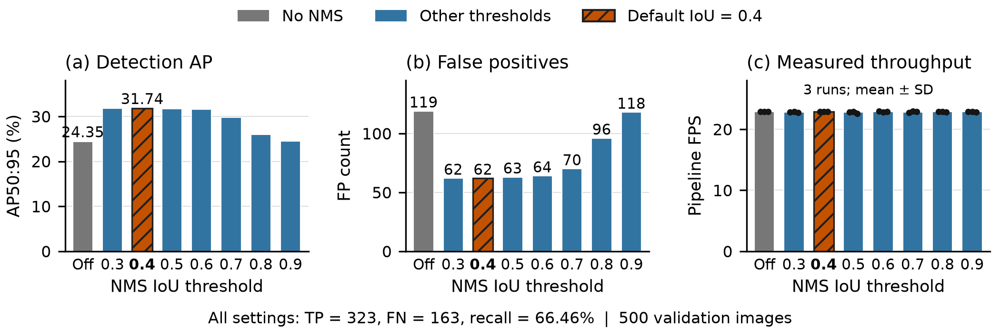

# NMS审计与VLM负面结果（2026-11-15）

已完成离线后处理审计、FP32／H10七档NMS重放和报告更新。新增Pi5／H10硬件计时已完成24次运行，原始预测逐图一致性及回传哈希核验通过。未启动新的GPU实验，也未修改原E0–E4或历史硬件结果。

## 重复框与实现审计

原YOLO26 `family=e2e` 路径实际执行one-to-one分支的Top-300筛选，不执行NMS；元数据中`nms_iou=0.7`对该分支无效，应区分配置记录与实际执行。原始模型按端到端设计导出，不能直接称作“漏写了本应启用的NMS”。

完整ONNX和原始检测头ONNX的输出依赖均含80个one-to-one节点，不含one-to-many或NMS节点。按语义节点名和参数位置核对，133个对应卷积的权重及偏置逐位一致。历史8样本导出检查支持原始头数值及conf0.25框集合等价；全500图原始头张量未重新推理，不能声称穷尽排除解码问题。

H10的119个FP中52个与已被TP覆盖的UAV重叠（IoU≥0.5）；FP32同类为57／126。其余H10 FP中13个IoU在[0.1,0.5)，54个低于0.1。这证明重复／匹配冲突在量化前已经存在，不能归咎于H10量化，也不足以断言P2或某一种损失是根因。

## 固定协议的NMS扫描

保存的0.001下限预测，在还原并裁剪至原图坐标后做贪心NMS，不改分数，max_det=300；固定工作点0.25。所有图为640×512。沿用原IoU优先一对一匹配与规范标注图序（相同分数稳定排序）；AP与固定工作点分别重匹配。无法恢复原Top-300之前已丢弃的候选。本节离线重放不包含训练或NPU计时；后续硬件测量与部署验收见下文。

独立标量NMS与现有实现：60个合成随机／空输入／同分／上限案例及严格IoU边界检查通过；实际500图×2来源×7阈值共7000例一致。先conf0.25筛选后NMS与先NMS后筛选完全一致。

| 来源 | NMS IoU | TP | FP | FN | Precision % | Recall % | AP50:95 % |
|---|---|---:|---:|---:|---:|---:|---:|
| FP32 | none | 328 | 126 | 158 | 72.247 | 67.490 | 25.186 |
| FP32 | 0.3 | 328 | 64 | 158 | 83.673 | 67.490 | 32.084 |
| FP32 | 0.4 | 328 | 65 | 158 | 83.461 | 67.490 | 32.074 |
| FP32 | 0.5 | 328 | 66 | 158 | 83.249 | 67.490 | 32.034 |
| FP32 | 0.6 | 328 | 68 | 158 | 82.828 | 67.490 | 31.789 |
| FP32 | 0.7 | 328 | 75 | 158 | 81.390 | 67.490 | 29.720 |
| FP32 | 0.8 | 328 | 106 | 158 | 75.576 | 67.490 | 26.522 |
| FP32 | 0.9 | 328 | 126 | 158 | 72.247 | 67.490 | 25.256 |
| H10 | none | 323 | 119 | 163 | 73.077 | 66.461 | 24.351 |
| H10 | 0.3 | 323 | 62 | 163 | 83.896 | 66.461 | 31.742 |
| H10 | 0.4 | 323 | 62 | 163 | 83.896 | 66.461 | 31.740 |
| H10 | 0.5 | 323 | 63 | 163 | 83.679 | 66.461 | 31.676 |
| H10 | 0.6 | 323 | 64 | 163 | 83.463 | 66.461 | 31.535 |
| H10 | 0.7 | 323 | 70 | 163 | 82.188 | 66.461 | 29.766 |
| H10 | 0.8 | 323 | 96 | 163 | 77.088 | 66.461 | 25.925 |
| H10 | 0.9 | 323 | 118 | 163 | 73.243 | 66.461 | 24.482 |

H10 IoU0.5：FP119→63，AP50:95 24.351%→31.676%，TP323／FN163不变；所有7档中，每张图的TP数均不变。IoU0.5仍删除了17个“原来被匹配为TP”的框，重匹配后由其他保留框覆盖，不能说没有删除原TP框。鸟类关联FP均为20，说明NMS没有解决鸟类语义混淆。

IoU0.3／0.4的本集合数字稍好，0.3比0.5只少1个FP、AP高0.066个百分点；不据此宣布最优。不同阈值的泛化和近邻目标误抑制需独立验证。本表是同一模型后处理消融；不能把其AP与旧FPS组合，或单独升级PinP2后据此宣称击败未作相同处理的其他模型。AP上升包含排序、重复抑制和匹配分配变化，不代表恢复了163个漏检。

## VLM作为有边界的负面结果

E3选择性context复核：TP184／FP12／FN302，Recall37.86%；E0为TP323／FP119／FN163，Recall66.46%。同召回的E1纯阈值对照FP11，优于E3。E2全量context只剩1个TP；E4更紧local裁剪TP183／FP12，未改善。

E3查询的141个原TP有126个被判背景、14个鸟、仅1个UAV；689次回答无UNCERTAIN。247候选原始最长边中位7.42像素，context目标面积占比中位0.76%，local为12.09%。E3保留196框中195框未查询VLM，收益主要来自置信度门控。E3查询均时236.93ms来自RTX2080Ti，绝非H10时延。

合理假设包括微小目标视觉证据不足、红外领域差异、否定式决策与不确定性未校准。但更紧裁剪已经试过，单纯继续放大／改措辞没有现成的成功证据；仍缺少语义正例和数值控制，不能证明VLM普遍不适合红外。冻结现有E0–E4及失败样例，不再扩大VLM实验或立即投入GPU。

后续仅先准备一小组人工确认的清晰UAV、鸟、背景对照，例如每类4张（12张），按目标大小记录、固定提示词、不显示GT答案。先检查最基本的识别与图像输入是否有效，必要时少量空白／打乱图像对照；不在该小组上反复调提示词，不把其结果视为泛化评价。此控制实验当前未运行。

## NMS硬件测速结果

冻结同一HEF与500张图，none及IoU0.3～0.9共8档，各3个新进程、每次20次预热。第一轮none→0.3→…→0.9；第二轮0.6→0.7→0.8→0.9→none→0.3→0.4→0.5；第三轮0.9→…→0.3→none。12,000次计时推理加480次预热，无新训练或GPU实验。各进程使用既有共享设备锁及900秒自有子进程超时保护。

**表VIII　Pi5／H10新增实测。** 每档3个独立进程，每次20次预热、500张图；按交错顺序执行。数值为3次运行均值±样本标准差，NMS计时在conf0.25下进行。

| NMS IoU | 管线毫秒／图 | FPS | NMS微秒／图 |
|---|---:|---:|---:|
| 不执行 | 43.74±0.05 | 22.86±0.02 | — |
| 0.3 | 43.88±0.12 | 22.79±0.06 | 26.7±0.4 |
| 0.4 | 43.70±0.02 | 22.89±0.01 | 26.3±0.1 |
| 0.5 | 43.93±0.33 | 22.77±0.17 | 26.4±0.3 |
| 0.6 | 43.73±0.16 | 22.87±0.08 | 26.5±0.1 |
| 0.7 | 43.80±0.22 | 22.83±0.12 | 26.5±0.6 |
| 0.8 | 43.76±0.08 | 22.85±0.04 | 26.9±0.2 |
| 0.9 | 43.78±0.13 | 22.84±0.07 | 26.8±0.3 |

8档共24次运行、12,000次计时推理，逐图重现冻结预测，过滤后预测也逐一匹配离线NMS。管线计时包括图像读取、预处理、H10同步调用、解码及固定阈值NMS，不含低分AP评估。IoU0.5管线平均43.93毫秒、22.77 FPS；新无NMS对照为43.74毫秒、22.86 FPS。NMS自身平均26.4微秒，IoU0.5管线P95的三次平均为46.18毫秒。计时过滤器处理的是500图共442个候选，不能据此推断候选密集场景的开销。完整管线的小幅差异不能证明NMS带来加速。所有记录的降频标志均为0。原跨模型表保留历史测量值。

计时范围为JPEG读取、PIL letterbox、UINT8转换、真实同步H10调用、有限值检查、主机解码和conf0.25 NMS；不包含模型初始化／预热、低分AP重放、指标计算、绘图、编码或网络。NMS使用还原并裁剪后的原图坐标。FPS为每次1000／平均毫秒的三次算术均值，P95为每次P95的三次平均，标准差使用ddof=1；不是摄像头实时FPS。

| NMS IoU | 管线P95毫秒（均值±SD） | NPU调用毫秒（均值±SD） | 最高运行后温度°C |
|---|---:|---:|---:|
| none | 45.648±0.386 | 23.498±0.026 | 53.45 |
| 0.3 | 45.612±0.355 | 23.507±0.015 | 52.90 |
| 0.4 | 45.335±0.353 | 23.477±0.017 | 52.90 |
| 0.5 | 46.178±1.606 | 23.488±0.011 | 51.80 |
| 0.6 | 45.474±0.567 | 23.471±0.024 | 52.90 |
| 0.7 | 45.528±0.548 | 23.486±0.021 | 52.35 |
| 0.8 | 45.325±0.165 | 23.499±0.009 | 52.35 |
| 0.9 | 45.610±0.361 | 23.506±0.040 | 52.35 |

24次运行的所有保存预测都与对应离线NMS逐元素相同，TP／FP／FN／AP经原评估器独立复算通过；每次输出文件及输入模型、数据、源码SHA均已校验。所有起止降频标志为0。原22.72 FPS保留为历史无NMS记录，本轮比较使用重新测量的no-NMS对照。

实际NMS开销较低，但仅对应500图共442个conf≥0.25候选，不能外推至候选密集场景。验证集484张含1个UAV、1张含2个不重叠UAV、15张无UAV；因此该集合也不足以验证近邻重叠目标的误抑制。阈值仍需独立样本确认，不能把同验证集事后最优称为泛化最优。VLM扩大实验继续暂停，少量清晰正例控制尚未运行。

[硬件汇总CSV](NMS_HARDWARE_20261115.csv) · [JSON](NMS_HARDWARE_20261115.json) · [24次完整运行统计](NMS_HARDWARE_RUNS_20261115.csv)

## 证据与复现

代码：[NMS重放](../../experiments/pinp2_nms/audit_nms.py)、[ONNX结构核对](../../experiments/pinp2_nms/audit_graph.py)、[硬件准备](../../experiments/pinp2_nms/prepare_hardware_bundle.py)、[硬件复核与汇总](../../experiments/pinp2_nms/summarize_hardware.py)。私有输出含全部16行指标、8000行逐图配对计数、原预测来源哈希、匹配冲突明细、IoU0.5预测及24次硬件运行的原始输出和时延；不提交原图、模型或设备信息。

术语固定：PinP2-YOLO；NMS为非极大值抑制；原无NMS管线与新增NMS变体分列；VLM为视觉语言模型；AP50:95为原共同部署口径。所有新结果均为内部验证集事后分析。

原评估器SHA-256：`4ce59eabea390503e36bf5078642d7f29b9f50f73256558c17e8f3d90ec6e87a`。

## 最终部署选择与实际执行（2026-11-15）

最终默认采用NMS IoU0.4（conf0.25、max300）：H10 TP323／FP62／FN163、AP50:95 31.740%。三轮阈值基准为22.89±0.01 FPS、43.70±0.02毫秒／图，NMS26.3±0.1微秒／图；新无NMS对照22.86±0.02 FPS。选择0.4是因为它是召回不变且达到最低FP的测试阈值中较大的一档；0.3仅多0.0026个百分点AP，0.5多1个FP，不用微小速度差异作为选点依据。

新的PinP2/H10部署入口实际在原图坐标还原及裁剪后调用NMS，绑定权重与HEF身份。500图默认策略验收未传入阈值覆盖，实际调用500次，442→385个候选（抑制57框），低分AP候选6969→4368；框、分数、顺序与冻结重放逐一相同，指标独立复算通过。20261115-nms04已发布为该PinP2部署的current版本。验收单次22.56 FPS／44.33毫秒，单列且不并入阈值基准三次重复；未安装摄像头常驻服务。

所选阈值与模型复用同500图验证集，属于内部工程选择；只有1张双UAV图且真值不重叠，密集目标行为未验证。163个漏检和20个鸟类关联FP没有改善。3次硬件重复不构成新增精度样本；当前少量候选的NMS成本不代表密集场景、独立视频或长期摄像头性能。

[实际部署用法](../../scripts/deployment/README.md) · [默认配置](../../configs/deployment/pinp2_h10.json) · [验收聚合回执](NMS_DEPLOYMENT_ACCEPTANCE_20261115.json)。原e2e解码器和历史评价脚本保留原样，以便复现无NMS基线。

图中所有柱状轴从0开始；FPS误差线为三轮样本标准差，黑点是各轮原始结果。完整数据见[汇总CSV](NMS_HARDWARE_20261115.csv)及[逐轮CSV](NMS_HARDWARE_RUNS_20261115.csv)。
